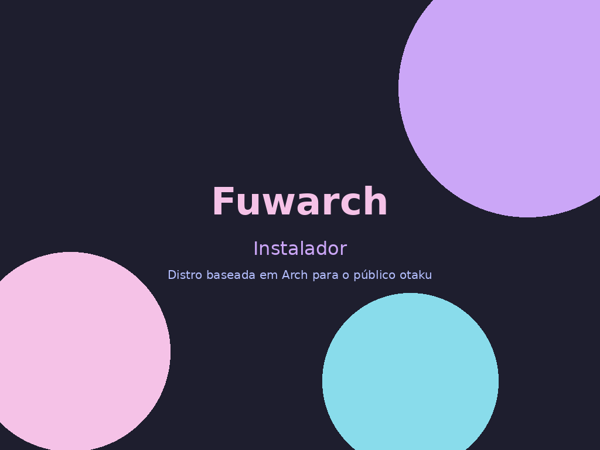

# Fuwarch Linux 🐰

  

**Arch-based** Linux distribution for the otaku audience. Fuwa fuwa (ふわふわ) + Arch. Pure rolling release, KDE Plasma + Hyprland, kawaii aesthetic (Catppuccin Mocha), mascot **Usami**.

> **Status:** Phase 0 — Foundation. No ISO released yet.

## Documentation (source of truth)

| File | Content |
|------|---------|
| [`01_diretrizes_projeto.md`](01_diretrizes_projeto.md) | Scope, visual identity, audience, resources, ADRs, licenses |
| [`02_passos_executados.md`](02_passos_executados.md) | Chronological log of everything done and tested |
| [`03_erros_e_solucoes.md`](03_erros_e_solucoes.md) | Bugs/breakages and exact solutions |
| [`04_guia_para_agentes.md`](04_guia_para_agentes.md) | Current state + IA handoff protocol |
| [`iso/fuwarch/README.md`](iso/fuwarch/README.md) | `archiso` build profile for the Fuwarch live ISO |

## Prototypes

- [`prototypes/kde/`](prototypes/kde/) — "Fuwarch Kawaii Mocha" theme for KDE Plasma (color scheme + Konsole).
- [`prototypes/sddm/`](prototypes/sddm/) — "Fuwarch Kawaii" SDDM theme.
- [`prototypes/terminal/`](prototypes/terminal/) — Starship prompt config.

## Licenses

- **Code:** MIT (GPLv3 when derived from GPL code).
- **Usami assets** (artwork, mascot, wallpapers): © Rukafuu, **CC BY-NC-ND 4.0**. Free distribution allowed; commercial use and derivatives prohibited.
- Third-party themes (Catppuccin, Tela Circle, etc.) keep their original licenses.

## Legal stance

No piracy tools in official project repositories. Fuwarch Linux is not affiliated with Arch Linux. Full disclaimer on the future website/ISO.
